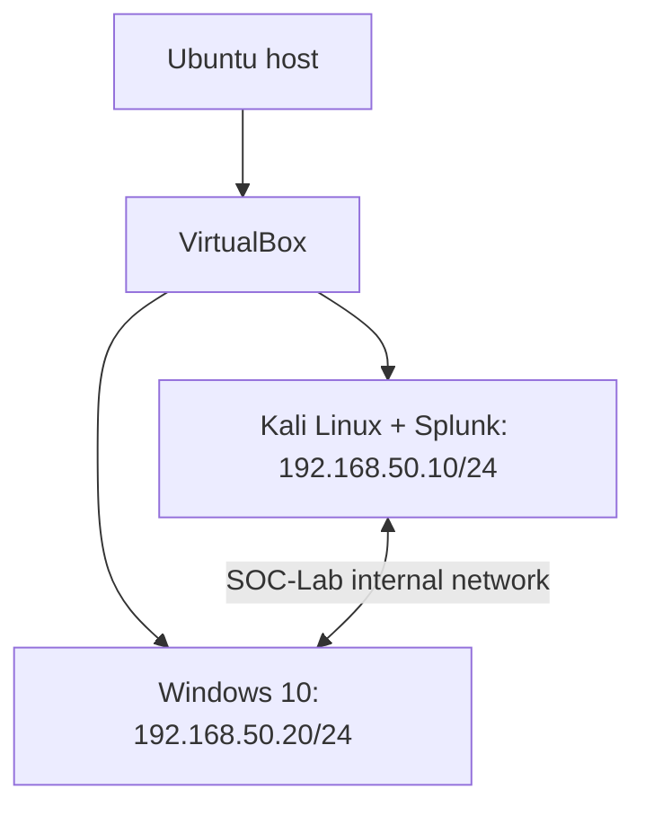
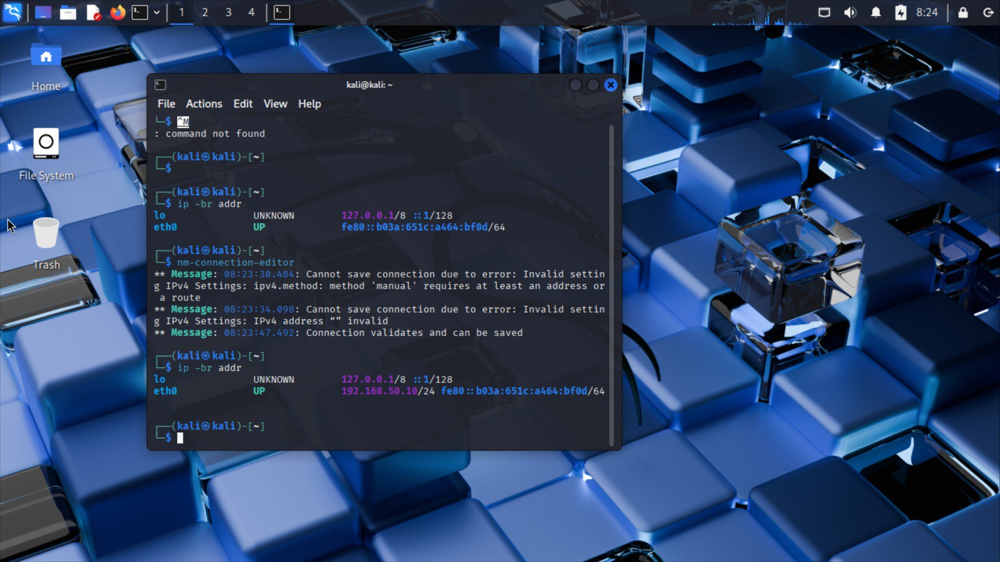
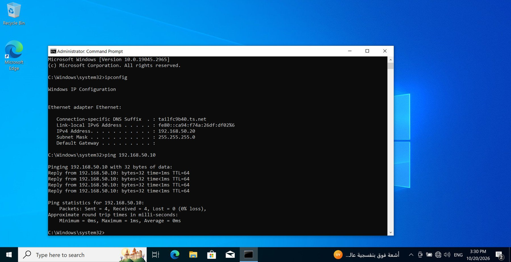
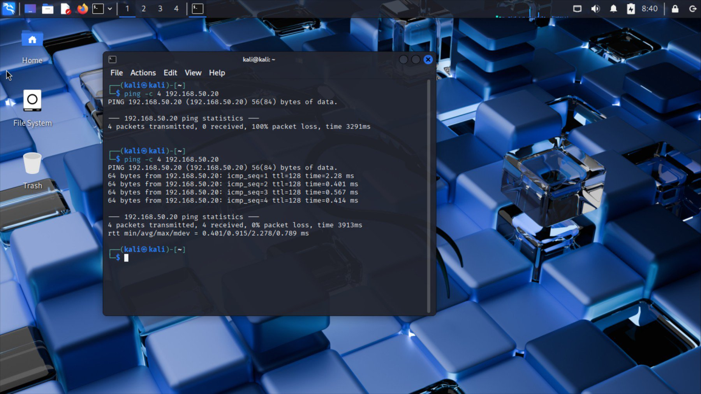
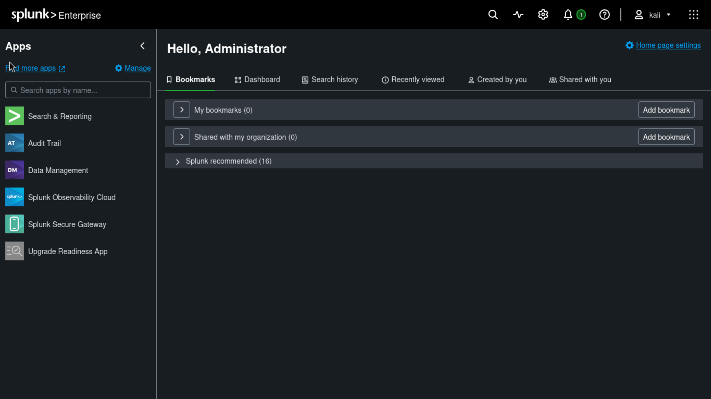
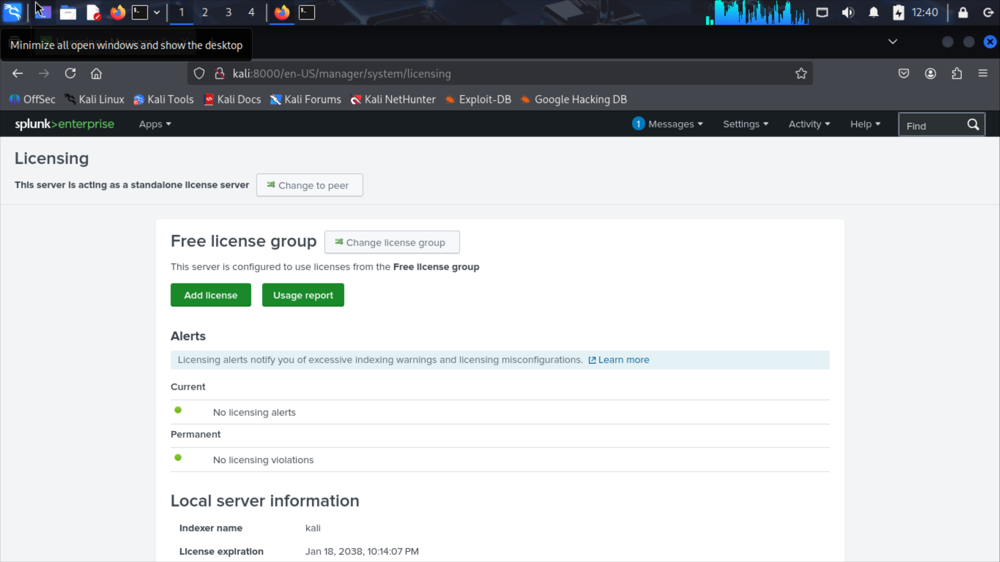

# SOC Home Lab: VirtualBox, Kali, Windows and Splunk

A VirtualBox lab on Ubuntu for practicing SOC monitoring and investigations. Kali hosts Splunk, and the Windows guest is the planned source of endpoint events. Both guests share the `SOC-Lab` internal network.

**Author:** Moataz Mostafa Ali Ibrahim  
**Lab implementation:** October–November 2026  
**Scope:** Lab infrastructure, endpoint log analysis and SIEM setup

## Verified outcome

- Kali Linux and Windows 10 ran as VirtualBox guests.
- Both guests used the internal network `SOC-Lab`.
- Static addresses placed the guests in the same `/24` subnet.
- Final ICMP tests received four replies from four requests in each direction.
- Reviewed Linux journal and Windows Security events locally.
- Splunk Web opened on Kali, and the Free license group was verified.

## Architecture



The host runs the hypervisor. The guest segment uses VirtualBox Internal Network rather than a bridge to the physical LAN. Host-to-guest access is not provided by that internal segment. Isolation described here applies to the documented adapter configuration; it is not a claim of a malware-safe sandbox.

## Environment

| Component | Documented configuration |
|---|---|
| Host | Ubuntu Linux |
| Hypervisor | VirtualBox 7.2.6-dfsg, reported during setup |
| Linux guest | Kali Linux; existing split VMDK image reused in a new VM |
| Windows guest | Windows 10, build 10.0.19045.2965 |
| Guest adapter | Adapter 1, Internal Network, name `SOC-Lab`, cable connected |
| Adapter model | Intel PRO/1000 MT Desktop (82540EM) |
| Subnet | `192.168.50.0/24` |
| Kali | `192.168.50.10/24` on `eth0` |
| Windows | `192.168.50.20`, mask `255.255.255.0` |
| SIEM | Splunk Enterprise 10.6.1.1 on Kali, using the Free license group |
| Gateway | Not required for direct communication within this subnet |

These are implementation details from the exercise, not recommendations to use these exact software versions today.

## Virtual machine and network setup

1. Used the existing Windows VM and created a Kali VM using the main VMDK descriptor, keeping its split disk parts together. Kali was not installed from an ISO in this exercise.
2. Powered off the guests and configured Adapter 1 on each as Internal Network with the identical name `SOC-Lab`.
3. Assigned manual IPv4 settings through NetworkManager on Kali and Ethernet TCP/IPv4 properties on Windows.
4. Checked addresses and tested communication in both directions.

## Network validation

### Address checks

Kali:

```bash
ip -br addr
```

Observed: `eth0` was UP with `192.168.50.10/24`.

Windows:

```cmd
ipconfig
```

Observed: `192.168.50.20` with mask `255.255.255.0` and no default gateway.

### Connectivity tests

Windows to Kali:

```cmd
ping 192.168.50.10
```

Kali to Windows:

```bash
ping -c 4 192.168.50.20
```

| Test | Result recorded in the exercise |
|---|---|
| Windows to Kali | Sent 4, received 4, lost 0; maximum RTT 1 ms |
| Kali to Windows, initial test | Sent 4, received 0; 100% loss |
| Kali to Windows, final retest | Sent 4, received 4; 0% loss; average RTT 0.915 ms |

The initial one-way failure made testing both directions necessary. The final retest demonstrates restored ICMP reachability. The available evidence does not establish the exact corrective change, so no firewall modification is claimed here.

## Network evidence

Screenshots from the original lab exercise are included below. Lab addresses are private IPv4 addresses.

### Internal network configuration

Both adapters use the same internal network name, `SOC-Lab`.


### Kali IPv4 validation

The final command output shows `eth0` UP with `192.168.50.10/24`.



### Windows-to-Kali connectivity

Windows shows its IPv4 configuration and four successful ping replies.



### Kali-to-Windows connectivity

The initial test shows 100% loss; the final retest shows four replies and 0% loss.



## Endpoint authentication log analysis

I reviewed native logs on both lab guests before adding Splunk. This established what each endpoint records and what a failed authentication event can tell an analyst.

### Linux authentication logs

On Kali, `/var/log/auth.log` was absent, so I searched the systemd journal. I also used `sudo tail -f /var/log/dpkg.log` to practice following a text log; the visible entries were existing package history.

```bash
sudo journalctl --no-pager |
  grep -Ei 'failed password|authentication failure|failed login' |
  tail -n 20
```

The search returned three historical `pam_unix(lightdm:auth)` failures on October 20, at 08:08:18, 08:08:29 and 08:08:38 as displayed. The events span 20 seconds. The `tty=:0` field is consistent with a graphical login; the remote host and remote user fields were blank. These records establish repeated authentication failures but do not identify an account, a remote source or an attack.

### Windows authentication logs

On Windows 10, I opened **Event Viewer → Windows Logs → Security**, entered `4624` and `4625` in the **Event IDs** field, and reviewed event details. I used the General view and XML to distinguish the requesting account from the account targeted by the failed logon.

| Evidence | What I observed |
|---|---|
| Event ID `4624` | A successful logon was present. The visible SYSTEM subject was the requester context; the target account was not visible in the captured view. |
| Event ID `4625`, record `703` | A failed interactive logon (type `2`) was recorded on 20 October 2026 at `09:40:30Z` in the event XML. |
| Failure fields | Both Status and SubStatus were `0xC000006E`. The displayed reason was generic; it did not establish that a password was mistyped. |
| Caller and source | The caller was `msedge.exe`; the source IP and port were not populated. The caller field alone does not establish malicious behavior. |

A single failed interactive logon is insufficient to classify brute force or remote access. The next analytical check would be to compare nearby failures and successes for the same account and examine process-creation evidence if available. The Linux and Windows findings are separate local observations; I did not correlate them as one incident.

## Splunk SIEM setup

I installed Splunk on the Kali guest and verified that Splunk Web opened locally and that the standalone instance was using the Free license group.

1. I downloaded the Splunk Linux `.deb` package and placed it in a read-only VirtualBox shared folder named `splunk-transfer`. The folder did not appear under `/media`, so I mounted it manually inside Kali and copied the installer to my home directory:

   ```bash
   sudo mkdir -p /mnt/splunk-transfer
   sudo mount -t vboxsf -o ro splunk-transfer /mnt/splunk-transfer
   sudo cp /mnt/splunk-transfer/splunk-10.6.1.1-b2ae2962645c-linux-amd64.deb "$HOME/"
   ```

2. I installed the package. Splunk refused the initial root startup without an explicit option, so I used the following commands for this lab run:

   ```bash
   sudo dpkg -i "$HOME/splunk-10.6.1.1-b2ae2962645c-linux-amd64.deb"
   sudo /opt/splunk/bin/splunk start --run-as-root
   ```

3. I opened `http://localhost:8000` in the Kali guest and signed in to verify the Splunk Web home page.

   

4. Under **Settings → Licensing → Change license group**, I switched from **Trial** to **Free**. I reopened Licensing and verified **Free license group**, with no licensing alerts or violations.

   

The screenshots show the initial sign-in and the license verification after switching to Free. The network tests verify ICMP reachability. Windows log forwarding, event ingestion, correlation and alerting have yet to be tested.

## Skills demonstrated

| Skill | Evidence from this project |
|---|---|
| Virtualization | Ran Kali and Windows guests on an Ubuntu host |
| Virtual networking | Configured matching internal-network adapters |
| IPv4 addressing | Assigned and checked static addresses in one subnet |
| Cross-platform administration | Used Linux and Windows networking tools |
| Troubleshooting | Compared an initial failed test with a successful retest |
| Authentication analysis | Filtered native Linux and Windows logs and assessed the limits of failed-logon evidence |
| SIEM setup | Installed Splunk on Kali and verified local web access and the Free license |
| Technical reporting | Recorded commands, outcomes and limits of the findings |

## Lessons learned

- Identical internal-network names matter: guest adapters must share the intended virtual segment.
- Direct same-subnet IP communication does not require a default gateway.
- Testing one direction alone can hide an asymmetric reachability problem.
- A successful ping is a specific observation, not proof that all services work.

## Next steps for the lab

- Configure Windows event collection into Splunk and verify that test events are searchable.
- Use the collected authentication events to investigate failed logons.

## References

- Oracle VirtualBox 7.2 User Guide, Virtual Networking: https://docs.oracle.com/en/virtualization/virtualbox/7.2/user/networkingdetails.html
- Kali Linux documentation: https://www.kali.org/docs/

## Attribution

Prepared from my SOC internship lab work, with AI assistance organizing the documentation.
