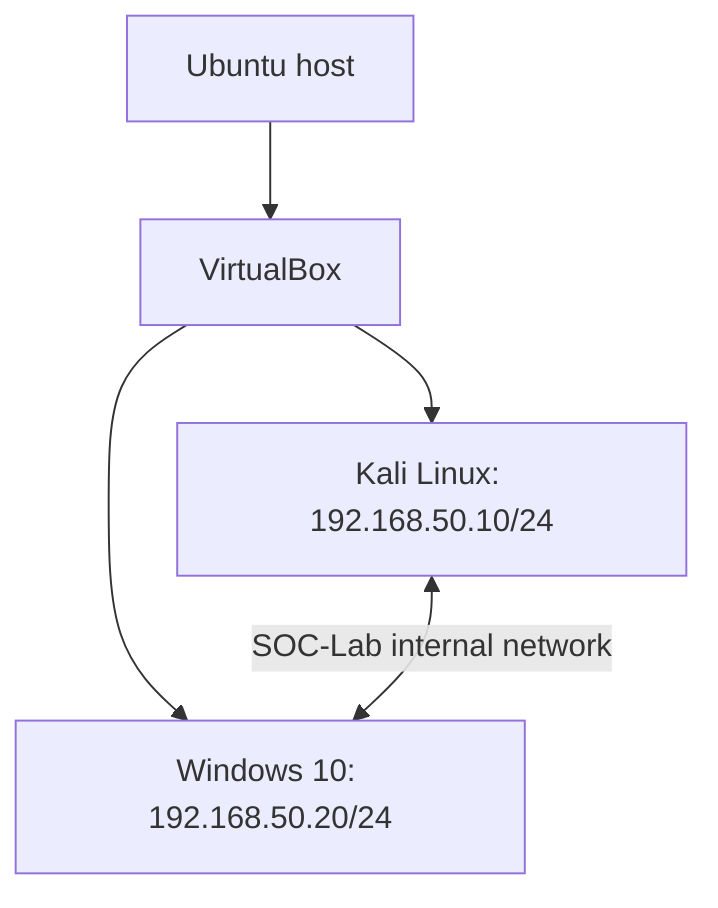
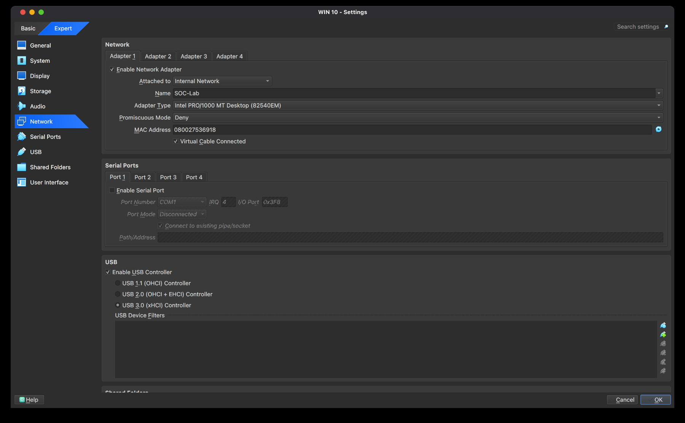

# SOC Home Lab: VirtualBox, Kali Linux and Windows

A two-VM lab built on an Ubuntu host to support future endpoint logging and security investigation exercises. This project documents virtual networking, static IPv4 configuration and measured connectivity results.

**Author:** Moataz Mostafa Ali Ibrahim  
**Lab implementation:** October 2026  
**Scope:** Lab infrastructure and connectivity validation

## Verified outcome

- Kali Linux and Windows 10 ran as VirtualBox guests.
- Both guests used the internal network `SOC-Lab`.
- Static addresses placed the guests in the same `/24` subnet.
- Final ICMP tests received four replies from four requests in each direction.

## Architecture



The host runs the hypervisor. The guest segment uses VirtualBox Internal Network rather than a bridge to the physical LAN. Host-to-guest access is not provided by that internal segment. Isolation described here applies to the documented adapter configuration; it is not a claim of a malware-safe sandbox.

## Environment

| Component | Documented configuration |
|---|---|
| Host | Ubuntu Linux |
| Hypervisor | VirtualBox 7.2.6-dfsg, reported during setup |
| Linux guest | Kali Linux; existing split VMDK image reused in a new VM |
| Windows guest | Windows 10, build 10.0.19045.2965 |
| Guest adapter | Adapter 1, Internal Network, name `SOC-Lab`, cable connected |
| Adapter model | Intel PRO/1000 MT Desktop (82540EM) |
| Subnet | `192.168.50.0/24` |
| Kali | `192.168.50.10/24` on `eth0` |
| Windows | `192.168.50.20`, mask `255.255.255.0` |
| Gateway | Not required for direct communication within this subnet |

These are implementation details from the exercise, not recommendations to use these exact software versions today.

## Implementation

1. Used the existing Windows VM and created a Kali VM using the main VMDK descriptor, keeping its split disk parts together. Kali was not installed from an ISO in this exercise.
2. Powered off the guests and configured Adapter 1 on each as Internal Network with the identical name `SOC-Lab`.
3. Assigned manual IPv4 settings through NetworkManager on Kali and Ethernet TCP/IPv4 properties on Windows.
4. Checked addresses and tested communication in both directions.

## Validation

### Address checks

Kali:

```bash
ip -br addr
```

Observed: `eth0` was UP with `192.168.50.10/24`.

Windows:

```cmd
ipconfig
```

Observed: `192.168.50.20` with mask `255.255.255.0` and no default gateway.

### Connectivity tests

Windows to Kali:

```cmd
ping 192.168.50.10
```

Kali to Windows:

```bash
ping -c 4 192.168.50.20
```

| Test | Result recorded in the exercise |
|---|---|
| Windows to Kali | Sent 4, received 4, lost 0; maximum RTT 1 ms |
| Kali to Windows, initial test | Sent 4, received 0; 100% loss |
| Kali to Windows, final retest | Sent 4, received 4; 0% loss; average RTT 0.915 ms |

The initial one-way failure made testing both directions necessary. The final retest demonstrates restored ICMP reachability. The available evidence does not establish the exact corrective change, so no firewall modification is claimed here.

## What the results establish

The results demonstrate guest operation, an aligned address plan and bidirectional ICMP reachability at test time. They do not establish that DNS, SMB, RDP, log forwarding or a SIEM was deployed or working.

## Skills demonstrated

| Skill | Evidence from this project |
|---|---|
| Virtualization | Ran Kali and Windows guests on an Ubuntu host |
| Virtual networking | Configured matching internal-network adapters |
| IPv4 addressing | Assigned and checked static addresses in one subnet |
| Cross-platform administration | Used Linux and Windows networking tools |
| Troubleshooting | Compared an initial failed test with a successful retest |
| Technical reporting | Recorded commands, outcomes and limits of the findings |

## Evidence

Screenshots from the original lab exercise are included below. Lab addresses are private IPv4 addresses.

### Internal network configuration

Both adapters use the same internal network name, `SOC-Lab`.




### Kali IPv4 validation

The final command output shows `eth0` UP with `192.168.50.10/24`.


### Windows-to-Kali connectivity

Windows shows its IPv4 configuration and four successful ping replies.


### Kali-to-Windows connectivity

The initial test shows 100% loss; the final retest shows four replies and 0% loss.


Source: my internship lab report, **Week1_Task3_SOC_Lab_Moataz_Mostafa.pdf**, 20 October 2026.

## Lessons learned

- Identical internal-network names matter: guest adapters must share the intended virtual segment.
- Direct same-subnet IP communication does not require a default gateway.
- Testing one direction alone can hide an asymmetric reachability problem.
- A successful ping is a specific observation, not proof that all services work.

## Next project

Use endpoint authentication records to investigate failed logons. Log analysis is documented as a separate lab so that infrastructure setup and investigation results remain easy to review.

## References

- Oracle VirtualBox 7.2 User Guide, Virtual Networking: https://docs.oracle.com/en/virtualization/virtualbox/7.2/user/networkingdetails.html
- Kali Linux documentation: https://www.kali.org/docs/

## Attribution

Prepared from my SOC internship lab work. Documentation was organized with AI assistance; the implementation claims are limited to the results recorded in the source report.
