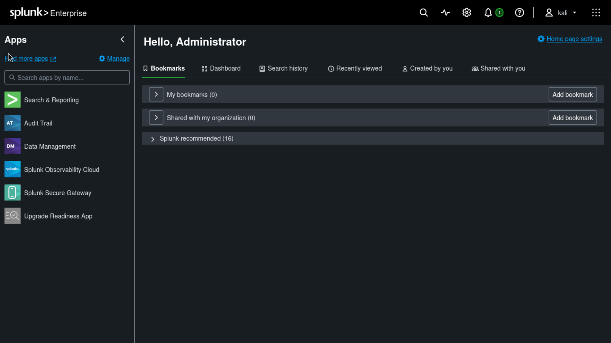
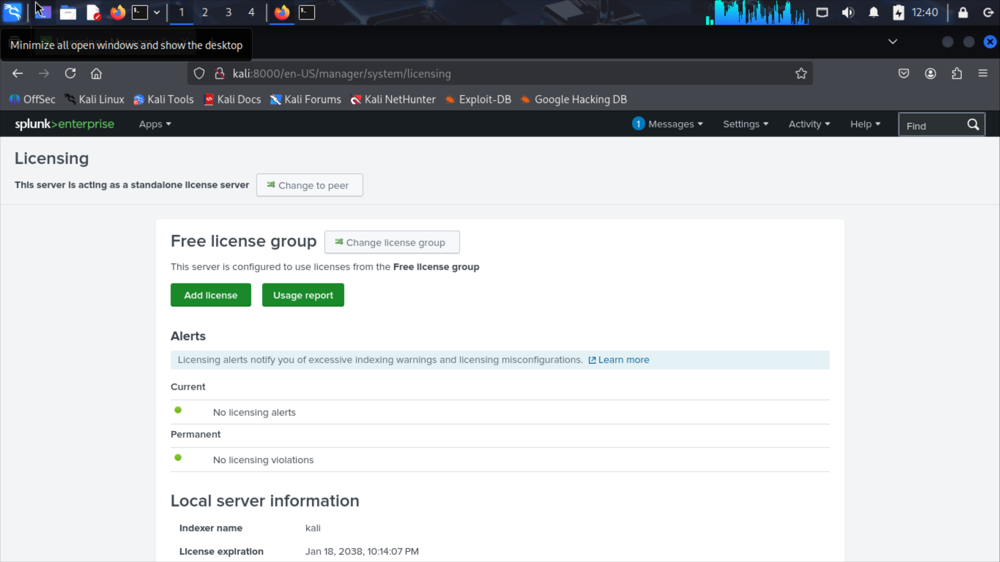

# Task 10: Splunk setup on Kali

**Completed:** 6 November 2026  
**Environment:** Ubuntu host, VirtualBox, Kali Linux guest, Splunk Enterprise 10.6.1.1 (Linux amd64).

I installed Splunk on the Kali guest in my [SOC home lab](../README.md), verified local access to Splunk Web and switched the standalone instance from Trial to the Free license group.

## Why a SIEM is useful

A SIEM collects and indexes events from sources such as endpoints, servers and firewalls. Centralized search gives analysts visibility across systems. Correlation and alerting can surface suspicious patterns, while dashboards and searchable timelines support triage and investigation.

## Installation

1. I downloaded the Splunk Linux `.deb` package and placed it in a read-only VirtualBox shared folder named `splunk-transfer`. The folder did not appear under `/media`, so I mounted it manually inside Kali and copied the installer to my home directory:

   ```bash
   sudo mkdir -p /mnt/splunk-transfer
   sudo mount -t vboxsf -o ro splunk-transfer /mnt/splunk-transfer
   sudo cp /mnt/splunk-transfer/splunk-10.6.1.1-b2ae2962645c-linux-amd64.deb "$HOME/"
   ```

2. I installed the package. Splunk refused the initial root startup without an explicit option, so I used the following commands for this lab run:

   ```bash
   sudo dpkg -i "$HOME/splunk-10.6.1.1-b2ae2962645c-linux-amd64.deb"
   sudo /opt/splunk/bin/splunk start --run-as-root
   ```

3. I opened `http://localhost:8000` in the Kali guest and signed in to verify the Splunk Web home page.

   

4. Under **Settings → Licensing → Change license group**, I switched from **Trial** to **Free**. I reopened Licensing and verified **Free license group**, with no licensing alerts or violations.

   

## Validation and scope

The screenshots verify that the web interface loaded and that the standalone instance was using the Free license group. The sign-in screenshot is from before the license change. External log ingestion, correlation, alerting and Windows log forwarding were outside the scope of this exercise.

I also completed TryHackMe's **Introduction to SIEM** room (100%) as part of the task.
